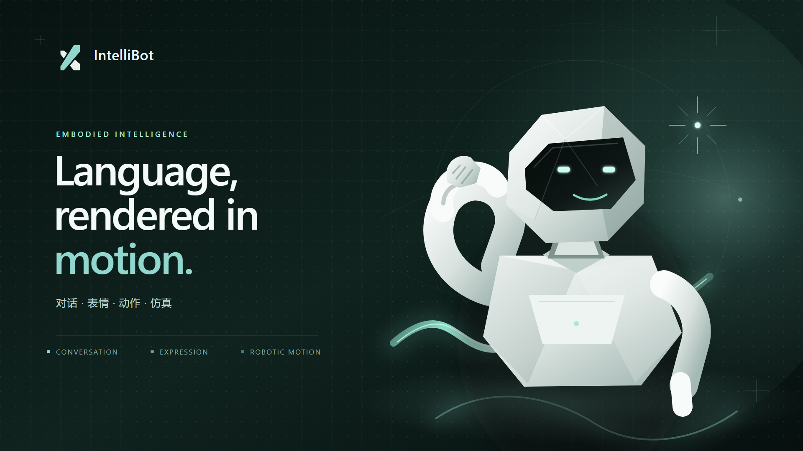

# IntelliBot



IntelliBot 是一个浏览器端智能机器人交互平台。首页提供实时 3D 机器人、表情与动作演示、角色设定、AI 对话、语音朗读、账号状态保存和动作卡片管理。

## 索引

[项目结构](#项目结构) · [快速开始](#快速开始) · [环境要求](#环境要求) · [首次安装](#首次安装) · [运行方式](#运行方式) · [常见问题](#常见问题)

## 项目结构

| 路径 | 内容 |
| --- | --- |
| `frontend/` | 页面、样式、3D 机器人、动作数据、对话和交互逻辑 |
| `backend/` | C++17 HTTP 后端、账号认证、用户状态与浏览器动作接口 |
| `backend/ai/` | 本地 AI 与语音服务 |
| `assistant/` | AI 动作能力清单 |
| `run.py` | 跨平台一键启动器 |
| `scripts/` | 依赖下载、后端构建和本地启动脚本 |
| `backend/tests/` | 后端接口、认证和会话测试 |
| `docs/` | 项目图片与前端来源说明 |

`backend-build/`、`.venv/`、`third_party/`、`data/` 和 `.env` 均为本地内容，不会提交到 Git。

## 快速开始

完成首次安装后，在项目根目录执行：

```bash
python run.py
```

启动器会自动完成以下工作：

1. 启动本地 AI 与语音服务；
2. 启动 C++ 后端；
3. 等待两个服务通过健康检查；
4. 自动打开 <http://127.0.0.1:8080/ui/IntelliBot.html>；
5. 按 `Ctrl+C` 同时停止本次启动的服务。

如果端口被修改，可以执行：

```bash
python run.py --port 8081 --ai-port 8093
```

只启动服务、不自动打开浏览器：

```bash
python run.py --no-browser
```

> 首次使用、缺少 Python 环境或没有后端程序时，请先完成首次安装。

## 环境要求

| 用途 | 需要 |
| --- | --- |
| 打开网页 | 支持 WebGL 2 的 Chrome、Edge 或其他现代浏览器 |
| 编译后端 | Git、C++17 工具链、CMake、Ninja、SQLite3、libsodium |
| 运行 AI 服务 | Python 3.11/3.12 |
| 使用模型对话 | 可用的模型 API Key |

项目不依赖 Conda。SQLite 和 libsodium 的获取方式取决于本机工具链；如果编译时提示缺失，请先安装对应开发库。

## 首次安装

### 1. 获取代码

```powershell
git clone https://github.com/UniqueUpstart/IntelliBot.git
cd IntelliBot
```

### 2. 创建 Python 环境

```powershell
python -m venv .venv
```

Windows：

```powershell
.\.venv\Scripts\python.exe -m pip install --upgrade pip
.\.venv\Scripts\python.exe -m pip install -r backend\ai\requirements.txt
```

macOS / Linux：

```bash
.venv/bin/python -m pip install --upgrade pip
.venv/bin/python -m pip install -r backend/ai/requirements.txt
```

后续可以直接使用 `python run.py`，启动器会优先找到项目内的 `.venv` 环境。

### 3. 配置 AI

```powershell
Copy-Item .env.example .env
notepad .env
```

macOS / Linux 使用：

```bash
cp .env.example .env
```

`.env` 已被 Git 忽略，不要提交真实 API Key。未配置 Key 时，登录、3D 展示、动作演示和账号状态仍可使用，AI 对话不可用。

### 4. 准备后端程序

在 Git Bash 中执行：

```bash
bash scripts/fetch_deps.sh
bash scripts/build_backend.sh
```

构建成功后应存在以下文件之一：

```text
backend-build/intellibot_backend.exe
backend-build/intellibot_backend
```

## 运行方式

### 一键启动

```bash
python run.py
```

`run.py` 会优先使用项目内的 `.venv` Python 环境和 `backend-build` 中的后端程序。若服务已经在线，它会复用现有服务；若本次由它启动，`Ctrl+C` 会一并清理。

### 分开启动（开发调试）

需要分别查看两个进程日志时，可以手动启动：

```powershell
.\.venv\Scripts\python.exe backend\ai\deepseek_bridge.py --port 8091
```

```powershell
.\backend-build\intellibot_backend.exe `
  --port 8080 `
  --web-root frontend `
  --db-path data\intellibot.db `
  --ai-url http://127.0.0.1:8091
```

页面必须通过 <http://127.0.0.1:8080/ui/IntelliBot.html> 打开，不能直接双击 HTML 文件。

### 只启动后端

在 Git Bash 中执行：

```bash
bash scripts/run_local.sh
```

也可以通过环境变量修改端口：

```bash
PORT=8081 bash scripts/run_local.sh
```

### 修改端口

```bash
python run.py --port 8081 --ai-port 8093
```

### 账号体验页

```powershell
.\backend-build\intellibot_backend.exe `
  --port 8080 `
  --web-root frontend `
  --db-path data\intellibot.db
```

打开 <http://127.0.0.1:8080/ui/experience.html>。

## 常见问题

| 现象 | 处理 |
| --- | --- |
| 找不到 `intellibot_backend` | 运行 `bash scripts/fetch_deps.sh && bash scripts/build_backend.sh` |
| 编译提示缺少 SQLite3 或 sodium | 安装对应开发库后重新构建后端 |
| 页面显示但 AI 对话不可用 | 使用 `python run.py` 启动会自动连接本地 AI 服务；随后检查 `.env` 或页面中的模型配置 |
| 登录接口不可用 | 确认页面从 `http://127.0.0.1:8080` 打开，且后端正在运行 |
| 3D 模型没有显示 | 确认完整保留了 `frontend/model/` 与 `frontend/lib/three/` |
| 端口被占用 | 执行 `python run.py --port 8081 --ai-port 8093`，或检查 `8080`、`8091` 的占用程序 |
| 直接双击 HTML 无法连接 | 网页必须通过 `http://127.0.0.1:8080` 打开 |

## 动作与 AI 能力

- 首页机器人模型位于 `frontend/model/q1_ff.glb`。
- 浏览器端动作数据位于 `frontend/js/q1_motion_data.js` 与各动作时间线文件。
- AI 可调用的动作、姿态、视角和表情白名单位于 `assistant/capabilities.json`。
- 新增 AI 动作时，需要同步更新前端动作数据与能力清单。

## 设计边界

- 首页机器人是浏览器端实时的 3D 动画展示，不连接 ROS 2 或真实机器人设备。
- 后端默认只监听 `127.0.0.1`；公网部署需要 HTTPS、反向代理和部署侧安全配置。
- AI 只返回文本和本地白名单中的动作 ID，动作最终由浏览器校验并播放。
- 对话最多依次执行四个动作，并支持通过文字或界面停止。
- API Key 不进入账号状态，也不会通过配置读取接口返回。
- 当前不提供密码找回、邮箱验证或私人动作库。

接口细节见 [后端说明](backend/README.md)。
