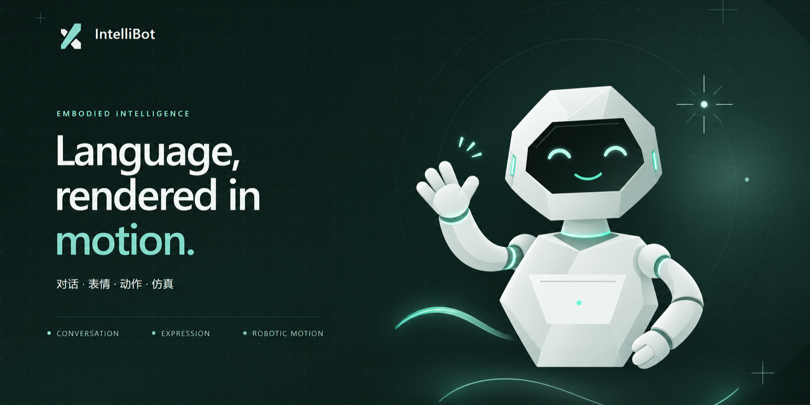

# IntelliBot



IntelliBot 是一个浏览器端智能机器人交互平台，提供实时 3D 机器人、动作与表情演示、角色设定、AI 对话、语音朗读、账号状态保存和动作卡片管理。

## 快速开始

```powershell
git clone https://github.com/UniqueUpstart/IntelliBot.git
cd IntelliBot
```
```powershell
python run.py
```

首次运行会自动创建 `.venv`、安装 Python 包及 CMake/Ninja、下载 C++ 头文件、编译后端，并启动 AI 服务与后端。完成后浏览器会打开：

<http://127.0.0.1:8080/ui/IntelliBot.html>

再次运行会复用已有环境，只做必要的增量编译。按 `Ctrl+C` 停止本次启动的服务。

## 环境要求

| 项目 | 要求 |
| --- | --- |
| 操作系统 | Windows 10/11 x64 |
| Python | 3.11–3.14 |
| Git | 用于获取代码和第三方头文件 |
| C++ | 支持 C++17 的编译器 |
| 浏览器 | 支持 WebGL 2 的 Chrome、Edge 或其他现代浏览器 |

> 当前仅在 Windows 10/11 x64 上完成完整验证。Linux/macOS 的跨平台构建路径尚未验证，WSL 不在启动器支持范围内。

CMake 和 Ninja 会自动安装到项目 `.venv`。SQLite3、libsodium 和 C++ 编译器会从当前环境自动发现；需要指定路径时，可参考下方的环境变量。

## 常用命令

| 命令 | 作用 |
| --- | --- |
| `python run.py` | 准备并启动完整服务 |
| `python run.py --bootstrap-only` | 只安装依赖并编译后端 |
| `python run.py --rebuild` | 强制重新配置并编译后端 |
| `python run.py --no-browser` | 启动时不自动打开浏览器 |
| `python run.py --port 8081 --ai-port 8093` | 修改后端与 AI 服务端口 |

需要覆盖默认配置时，可设置以下环境变量：

`PORT`、`AI_PORT`、`DEPS_MIRROR`、`INTELLIBOT_PYTHON`、`INTELLIBOT_CXX`、`INTELLIBOT_GIT`、`INTELLIBOT_DEPS_PREFIX`。

## 配置 AI

启动服务后，在页面顶部进入 `Settings → AI 模型`，也可以点击聊天栏的模型胶囊选择“管理 API 与模型”。

选择 DeepSeek、智谱 GLM 或自定义模型，填写 API Key；如有需要，再修改接口地址和模型名称，最后点击“应用”。

配置保存在本机 `data/ai_config.json`，不会进入 Git、浏览器存储或账号状态。普通本地运行不需要创建 `.env`；未配置 API Key 时，登录、3D 展示、动作演示和账号状态仍可使用，只有 AI 对话和语音合成不可用。

## 开发与测试

### 分开启动

先完成初始化：

```powershell
python run.py --bootstrap-only
```

然后在两个终端中分别启动 AI 服务和后端：

```powershell
# 终端 1
.\.venv\Scripts\python.exe backend\ai\deepseek_bridge.py --port 8091

# 终端 2
.\backend-build\intellibot_backend.exe `
  --port 8080 `
  --web-root frontend `
  --db-path data\intellibot.db `
  --ai-url http://127.0.0.1:8091
```

通过 `run.py` 启动时，日志位于 `log/ai.log` 和 `log/backend.log`；手动分开启动时，输出直接显示在各自终端。页面必须通过本地 HTTP 地址打开，不能直接双击 HTML 文件。

### 测试

```powershell
.\.venv\Scripts\ctest.exe --test-dir backend-build --output-on-failure
```

接口和浏览器验收说明见 [后端说明](backend/README.md)。

## 项目结构

```text
frontend/        页面、3D 模型、动作数据和交互逻辑
backend/         C++17 后端、账号认证与 API
backend/ai/      本地 AI 与语音服务
assistant/       AI 动作能力清单
run.py           环境引导、编译与一键启动
scripts/         兼容脚本与本地运行辅助脚本
backend/tests/   接口、认证和会话测试
docs/            图片与项目文档
```

以下目录由本地运行生成，不提交到 Git：

```text
.venv/           项目 Python、CMake、Ninja 与依赖
third_party/     C++ HTTP 与 JSON 头文件
backend-build/   编译后的后端程序
log/             运行日志
data/            账号数据库与 AI 配置
```

## 说明与限制

- 首页机器人是浏览器端的实时 3D 动画，不连接 ROS 2 或真实机器人设备。
- AI 只能使用 `assistant/capabilities.json` 中的动作、姿态、视角和表情；新增动作时还需同步更新前端动作数据。
- AI 对话最多依次执行四个动作，并支持通过文字或界面停止。
- 后端默认只监听 `127.0.0.1`。公网部署需要额外配置 HTTPS、反向代理和部署侧安全策略。
- 当前不提供密码找回、邮箱验证或私人动作库。

## 常见问题

| 现象 | 处理 |
| --- | --- |
| 首次启动较慢 | 首次需要下载依赖并编译后端，保持终端窗口打开 |
| 找不到后端程序 | 运行 `python run.py --bootstrap-only` |
| `.venv` 损坏 | 直接运行 `python run.py`，启动器会尝试重建 |
| 缺少 SQLite3 或 sodium | 准备对应开发库，或通过 `INTELLIBOT_CXX` / `INTELLIBOT_DEPS_PREFIX` 指定环境 |
| AI 对话不可用 | 在 `Settings → AI 模型` 中填写并应用 API Key |
| 端口被占用 | 使用 `--port` 和 `--ai-port` 修改端口 |
| 页面资源加载失败 | 确认通过 `http://127.0.0.1:8080` 打开，而不是双击 HTML |
