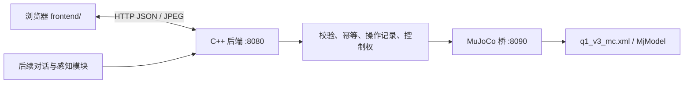

# 文档2：Aloria 仿真交互需求分析

状态：仿真化改造后的基线。项目通过 MuJoCo 模拟机器人，不连接 ROS 2、真机或外部服务。

## 1. 产品目的

在浏览器里完成“观察机器人 → 控制姿态与动作 → 与 AI 交互”的闭环。
机器人本体由 MuJoCo 模型代替，所有指令只影响仿真进程，不改动任何硬件。

## 2. 谁在什么情况下使用

| 用户 | 需求 | 完成后的体验 |
|---|---|---|
| 调试同学 | 判断后端与仿真桥是否可用 | 看到连接状态、仿真桥错误和最近操作 |
| 操作同学 | 手动摆姿、走位、做手势 | 拖动关节、选择预设/手势/步态，画面即时反馈 |
| 演示人员 | 稳定展示固定流程 | 一键切预设姿态或步态，画面连续 |
| 算法同学 | 把感知或对话结果变成动作 | 通过统一 HTTP 接口下发，不直接碰仿真内部 |

## 3. 架构

页面只依赖业务接口，不依赖 MuJoCo 字段；桥不可用时后端返回 502，不伪装成功。

## 4. 交付层次

| 层次 | 功能 | 状态 |
|---|---|---|
| M0：可运行后端骨架 | HTTP、JSON、模拟连接、操作记录、参数校验、请求去重、仿真转发 | 已实现并有集成测试 |
| M1：仿真操控 | 关节表与滑块、预设姿态、手势、步态、底盘移动、急停、相机取景 | 已实现 |
| M2：画面与状态 | JPEG 帧、关节/接触/足底状态、速度与模式切换 | 已实现 |
| M3：AI 交互 | 对话、语音播报、场景编排、动作学习 | 播报与动作接口已有模拟分支，对话尚未接入 |

## 5. 功能定义与验收

| 模块 | 明确行为 | 验收依据 |
|---|---|---|
| 连接 | 检查仿真桥 `/health`，失败时给出原因 | 桥未启动必须报 502 |
| 状态 | 关节、接触点、足底高度、连接状态 | 数值来自桥，不由前端编造 |
| 关节控制 | 单关节目标角，按限位与速度约束 | 桥真实修改 qpos |
| 预设/手势/步态 | 选择白名单内的名称 | 未知名称返回 422 |
| 移动 | 前后左右与转向，松开即停 | 超时与失焦同样清零 |
| 停止 | 按钮释放、失焦、Esc、断连都尝试停止 | 断开连接时后端向桥发 stop |
| 画面 | 离屏渲染 JPEG，可开关 | 取不到帧时显示离线态，不缓存旧帧 |
| 播报/音量 | 模拟受理并记录，不发声 | 返回 `simulated` |
| 日志 | 请求与操作记录可查询 | 按 `after_id` 增量拉取 |

## 6. 边界

- 不支持真机 / ROS 2 连接、设备扫描、账号、OTA、标定与技能市场。
- 仿真桥与后端只监听 `127.0.0.1`，无认证，不面向局域网多用户。
- 仿真里的急停只是软件停止，不代表任何物理安全能力。